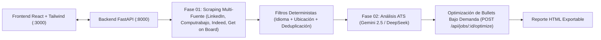
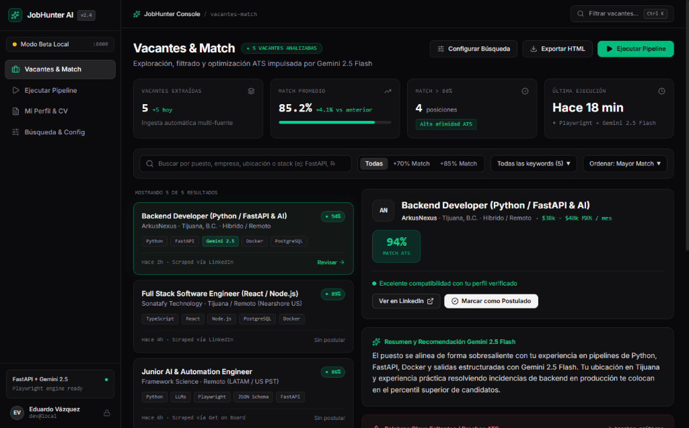
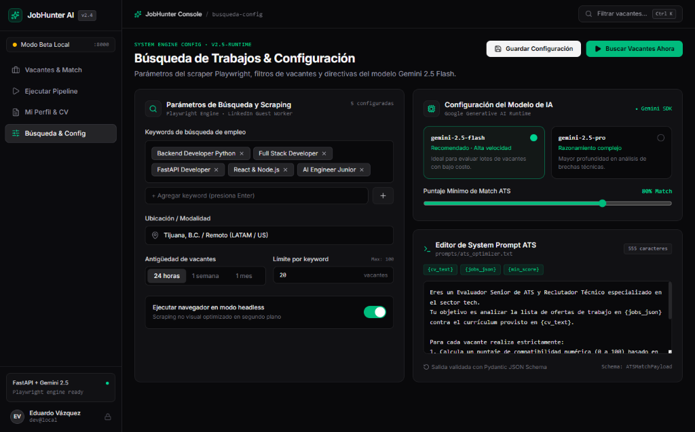

# JobHunter AI — Pipeline Multi-Fuente de Búsqueda de Empleo y Optimización ATS

Aplicación **Full Stack containerizada** construida con **FastAPI, React (Vite + Tailwind CSS), Playwright, Docker Compose e IA Generativa (Google Gemini / DeepSeek)** que automatiza la búsqueda multi-fuente de vacantes, aplica filtros deterministas de idioma y ubicación, calcula compatibilidad ATS contra tu currículum en **JSON estructurado** y optimiza bullets bajo demanda.

---

## Arquitectura y Flujo del Pipeline



---

## Funcionalidades Principales

### Fase 01 — Extracción Multi-Fuente, Filtros Deterministas y Persistencia SQLite
- **Plataformas configurables (`scrapers/`):**
  - **LinkedIn** (`linkedin_scraper.py` vía Playwright con soporte para filtro remoto `&f_WT=2`).
  - **Computrabajo MX** (`scrapers/computrabajo_scraper.py`).
  - **Indeed MX** (`scrapers/indeed_scraper.py` con detección limpia de verificación).
  - **Get on Board** (`scrapers/getonboard_scraper.py` vía API JSON pública oficial).
- **Persistencia e historial SQLite (`backend/db.py`):** Almacena todas las vacantes en `data/jobhunter.db` deduplicadas por hash SHA-256 de URL (manteniendo espejos JSON compatibles), evitando re-analizar vacantes ya procesadas y preservando notas y estados CRM entre ejecuciones.
- **Filtros previos al consumo de IA:**
  - **Filtro de idioma (`exclude_english`):** Descarta vacantes redactadas en inglés o que exijan inglés conversacional/avanzado antes de gastar tokens.
  - **Filtro geográfico (`work_mode`):** Modos rápidos **Local Tijuana**, **México Remoto** o **Tijuana + Remoto**, descartando vacantes presenciales de otros países.

### Fase 02 — Análisis ATS por Lotes, Mensaje a Reclutador y Alertas
- **Multi-proveedor de IA:** Selector entre **Google Gemini** (`gemini-2.5-flash`, `gemini-2.5-pro`) y **DeepSeek** (`deepseek-chat`, `deepseek-reasoner`), con botón **Testear Conexión** (`POST /api/ai/test`) y medición de latencia.
- **Análisis por lotes (`batch_size`):** Evalúa múltiples vacantes en una sola petición estructurada (enviando el CV una única vez por lote con fallback individual automático), reduciendo ~70% el consumo de tokens de entrada.
- **Optimización y contacto en 1 clic:**
  - **Optimizar Bullets con IA** (`POST /api/jobs/{id}/optimize`) solo en las vacantes de interés.
  - **Mensaje Directo para Reclutador** (`POST /api/jobs/{id}/outreach`) redactado en español para LinkedIn o correo.
- **Automatización programada y alertas (`backend/notifier.py`):** Ejecución periódica opcional en segundo plano (`6h`, `12h`, `24h`) con notificaciones automáticas a **Discord Webhook** o **Telegram Bot** cuando aparecen vacantes que superan el puntaje objetivo.

### Consola Web Interactiva, Mini-CRM y Exportación de CV Adaptado
- **Vacantes & Match (Mini-CRM):** Paneles con desplazamiento independiente, KPIs en vivo, búsqueda global (`Ctrl + K`), estados de seguimiento (*Por revisar*, *Postulado*, *En entrevista*, *Descartada*), botón rápido para ocultar descartadas y notas persistentes por vacante.
- **Exportación directa de CV adaptado (`backend/exporter.py`):** Descarga inmediata en **PDF** (`fpdf2`) o **DOCX** (`python-docx`) inyectando los bullets optimizados para la vacante seleccionada (`GET /api/jobs/{id}/export-cv?format=pdf|docx`).
- **Mi Perfil & CV:** Editor Markdown con vista previa ATS en tiempo real y **carga directa de CV en PDF** (`POST /api/cv/upload-pdf` vía `pypdf`).
- **Ejecutar Pipeline:** Consola de logs en vivo mediante polling sobre FastAPI con controles para correr Fase 01 + Fase 02 juntas o por separado.

---

## Capturas de Pantalla

<table>
  <tr>
    <td align="center" width="50%">
      <br />
      <sub><b>Dashboard Vacantes & Match — KPIs, filtros en vivo y vista maestro-detalle</b></sub>
    </td>
    <td align="center" width="50%">
      <br />
      <sub><b>Búsqueda & Config — Keywords, fuentes, proveedor IA y System Prompt</b></sub>
    </td>
  </tr>
</table>

---

## Stack Tecnológico

| Capa | Tecnologías |
| :--- | :--- |
| **Backend & Persistencia** | Python 3.11+, FastAPI, Uvicorn, SQLite3, Pydantic, `cryptography` (Fernet), `pypdf`, `python-docx`, `fpdf2`, `python-dotenv` |
| **Frontend** | React 19, Vite 7, Tailwind CSS v4, Lucide React |
| **Automatización & IA** | Playwright (Chromium), Google Gemini API, DeepSeek API |
| **Contenedores** | Docker, Docker Compose, Nginx |

---

## Estructura del Proyecto

```text
scraper_job/
├── backend/
│   ├── api.py                    # API REST FastAPI (config, CV PDF, jobs, pipeline, test IA)
│   ├── requirements.txt          # Dependencias Python
│   └── Dockerfile                # Imagen del backend
├── frontend/
│   ├── src/components/           # VacantesView, SearchConfigView, PipelineView, ProfileCvView, Sidebar
│   ├── Dockerfile                # Build multi-stage (Node + Nginx)
│   └── nginx.conf                # Reverse proxy /api -> backend:8000
├── scrapers/
│   ├── getonboard_scraper.py     # API oficial de Get on Board con filtro de elegibilidad
│   ├── computrabajo_scraper.py   # Extractor Computrabajo MX
│   ├── indeed_scraper.py         # Extractor Indeed MX
│   └── utils.py                  # Config loader y filtro de idioma
├── linkedin_scraper.py           # Extractor LinkedIn parametrizado por config.json
├── multi_scraper.py              # Orquestador Fase 01 multi-fuente
├── ai_optimizer.py               # Motor Fase 02 (Gemini / DeepSeek + optimización individual)
├── run_pipeline.py               # Orquestador CLI de extremo a extremo
├── prompts/ats_optimizer.txt     # Plantilla editable del System Prompt ATS
├── profile/cv.example.md         # Plantilla pública de CV
├── config.example.json           # Plantilla pública de configuración
├── .env.example                  # Plantilla de variables de entorno
└── docker-compose.yml            # Levantamiento completo (frontend :3000 + backend :8000)
```

---

## Instalación y Ejecución

### Opción 1 — Con Docker Compose (1 comando)

1. Copia los archivos de ejemplo y agrega tu clave en `.env`:

```bash
cp .env.example .env
cp config.example.json config.json
cp profile/cv.example.md profile/cv.md
```

2. Levanta backend y frontend:

```bash
docker compose up --build
```

- **Interfaz Web:** `http://localhost:3000`
- **API FastAPI / Swagger Docs:** `http://localhost:8000/docs`

### Opción 2 — En local (desarrollo)

**Backend:**
```bash
python -m venv .venv
# Windows: .venv\Scripts\activate | Linux/Mac: source .venv/bin/activate
pip install -r backend/requirements.txt
playwright install chromium
uvicorn backend.api:app --reload --port 8000
```

**Frontend:**
```bash
cd frontend
npm install
npm run dev
```

---

## Privacidad y Seguridad

El archivo [`.gitignore`](./.gitignore) excluye automáticamente toda información sensible, llaves de cifrado y artefactos generados en ejecución:
- `.env` y `.vault.key` (las API keys y webhooks se almacenan encriptados localmente con **Fernet AES-128 + HMAC-SHA256** mediante `backend/crypto_vault.py`)
- `config.json` (preferencias locales)
- `profile/cv.md` (currículum personal)
- `data/`, `*.db` y archivos de resultados (`resultados_scraping.json`, `resultados_optimizados.txt`, `resultados_convertidos.html`)

---

## Licencia

Uso local / educativo — Código abierto para búsqueda de empleo y optimización ATS.
